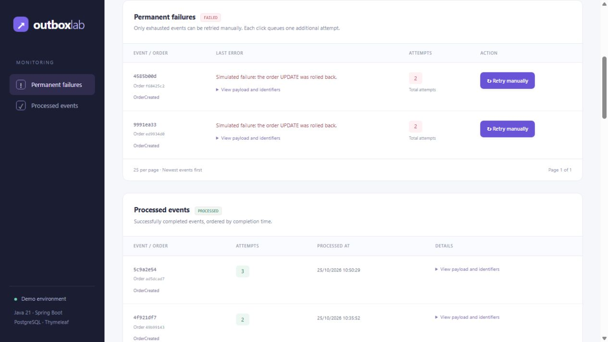

# Outbox Lab

A small Java 21, Spring Boot 3.5.16, Spring JDBC, Thymeleaf, and PostgreSQL 17 example of transactional event storage and background processing.

The dashboard has separate lists for processed events and permanent failures, each with 25 rows per page. The worker makes an initial attempt and one automatic retry after 12 seconds. Only events that exhaust those attempts can be retried manually. Orders are submitted through the standalone script or API.



Application identifiers and documentation use English. Source code comments use Portuguese.

## Run with Docker

Start Docker Desktop and run from this directory:

```sh
docker compose up --build -d
```

Open **http://localhost:8080** after startup completes.

```sh
docker compose logs -f app
docker compose down
```

PostgreSQL is available at `localhost:5433`. The database, username, and password are `outbox`. The named volume preserves data across restarts. Ports bind to loopback for this local demonstration.

## Manual simulation

Requires PowerShell 7 or later. From the project directory:

```powershell
pwsh -File ./scripts/Send-Orders.ps1 -Count 100

pwsh -File ./scripts/Send-Orders.ps1 -Count 100000 -DelayMs 5

pwsh -File ./scripts/Send-Orders.ps1 -Count 1000 -FailureEvery 10

pwsh -File ./scripts/Send-Orders.ps1 -Count 5 -FailureEvery 1 -FailureAttempts 2

pwsh -File ./scripts/Send-Orders.ps1 -Count 500 -ProductPrefix "Brake pad" -Quantity 2 -BaseUrl http://localhost:8080
```

The script sends sequential `POST /orders` requests using a reused HTTP client. Each request exercises validation, the order/event transaction, notifications, and normal processing. It keeps only counters and the last order ID, so it does not accumulate 100,000 payloads in memory.

| Parameter | Default | Meaning |
|---|---:|---|
| `Count` | 100 | Number of requests, from 1 through 100,000 |
| `BaseUrl` | `http://localhost:8080` | Application root URL |
| `Quantity` | 1 | Units per order, from 1 through 999 |
| `DelayMs` | 0 | Additional delay between requests, from 0 through 60,000 ms |
| `FailureEvery` | 0 | Simulate errors every N requests; 0 disables them |
| `FailureAttempts` | 1 | Number of attempts that fail for each selected event, from 1 through 100 |
| `ProductPrefix` | `Simulation` | Product prefix; a run ID and sequence number are appended |
| `TimeoutSeconds` | 30 | Timeout per request |
| `ContinueOnError` | false | Continue submitting subsequent requests after an error |

The summary reports requested/attempted/created counts, failed or unknown results, elapsed time, creation rate, and the last order ID. HTTP 201 means the order and event were stored, not that processing has finished. The script does not wait for all events to complete.

There are no automatic HTTP retries: a timeout can occur after the server committed, and this demo's creation endpoint has no request idempotency key. The default is to stop after the first error; `ContinueOnError` continues with the remaining requests and still reports an error at the end. Successful submissions remain stored.

Sending 100,000 requests takes time with the sequential script: it prioritizes bounded memory and controlled pressure over maximum throughput. `-FailureEvery 1 -FailureAttempts 2` makes every event exhaust its automatic retry budget and appear in the permanent-failure list.

## 50,000 requests per second target

For concurrent, rate-controlled load, install [Grafana k6](https://grafana.com/docs/k6/latest/set-up/install-k6/) and run:

```powershell
pwsh -File ./scripts/Invoke-LoadTest.ps1 -DryRun
pwsh -File ./scripts/Invoke-LoadTest.ps1 -Rate 50000 -DurationSeconds 2
```

This targets 100,000 requests total, with 32 preallocated virtual users and a ceiling of 128 by default. The rate is a target; the existing small-memory application and the generator may not sustain it. Insufficient capacity, dropped iterations, wrong HTTP statuses, or incomplete request volume make the test fail. Reports distinguish the configured rate from measured submissions and HTTP 201 responses. HTTP acceptance does not measure background worker completion.

See [LOAD-TEST.md](docs/LOAD-TEST.md) for installation, concurrency tuning, low-volume smoke tests, failure simulation, report fields, and verification results. The full 50,000-RPS burst is intended for manual execution.

## Inspect and retry a failed event

1. Run `pwsh -File ./scripts/Send-Orders.ps1 -Count 5 -FailureEvery 1 -FailureAttempts 2`.
2. Wait for the initial failure and the automatic retry after 12 seconds. Events become `FAILED` after the second error.
3. Expand **View payload and identifiers** to inspect the event.
4. Click **Retry manually** on a permanent failure to queue one additional attempt.
5. The worker processes it; on success, the event moves to the processed list with three total attempts.

On processing failure, a JDBC savepoint rolls back the order UPDATE. The first error puts the event in `RETRY` for 12 seconds. If the next attempt also fails, the event becomes `FAILED` and is excluded from the worker's queue and timer. `max-attempts: 2` in `application.yml` sets the total automatic attempt budget. `FailureAttempts=1` demonstrates automatic recovery; `FailureAttempts=2` demonstrates manual recovery after exhaustion.

Manual recovery atomically changes only a `FAILED` event to `PENDING`. PostgreSQL notifies the worker after commit. The event ID, payload, order ID, previous error, and cumulative attempt count are preserved; only an actual attempt increments the counter. Concurrent or repeated clicks queue at most one additional attempt. Pending, automatically retrying, and processed events cannot be manually requeued.

Manual recovery does not reset the automatic budget. If that additional attempt fails, the event remains `FAILED` until another manual request. Use `FailureAttempts=3` to demonstrate one failed manual recovery followed by a successful fourth attempt. An operator would normally investigate and fix the underlying cause before retrying a real permanent failure.

The dashboard has no creation form, global processing button, or pause controls. `WORKER_ENABLED` defaults to `true`; setting it to `false` through application configuration pauses background processing for local inspection.

## Processing flow

```text
POST /orders
    |
OrderService.create
Transaction A: INSERT order + INSERT outbox + trigger NOTIFY
    |
COMMIT; API returns 201 Created
    |
LISTEN/NOTIFY wakes OutboxWorker
    |
OutboxRunner.processNext
Transaction B: SELECT ... FOR UPDATE SKIP LOCKED
    |
OrderProcessor.process: conditional UPDATE order
    |
UPDATE outbox: PROCESSED
COMMIT transaction B
```

Transaction A stores the order and event together. An event insert failure also rolls back the order. After commit, processing runs independently and may begin before the HTTP response reaches the client.

Each processing attempt uses its own transaction. The worker locks an eligible event, calls the processor, and completes the event. The processor uses `Propagation.NESTED` to create a JDBC savepoint: a processing error rolls back the order changes while allowing the outer transaction to record the retry. If event completion fails, the whole transaction rolls back.

The conditional order UPDATE makes repeated processing of the same order idempotent. Already processed orders retain their original processing timestamp.

Event availability and retry delays use the PostgreSQL clock. An application clock that is ahead of the database cannot accidentally postpone a newly inserted event. The worker also obtains the remaining delay from PostgreSQL rather than comparing timestamps from different machines.

## Notifications, retries, and recovery

Migration V3 adds statement-level triggers for INSERTs and updates to `available_at`. Notifications are delivered only after commit and are not delivered after rollback. The payload remains in the table; the signal merely means there may be work.

- A dedicated PostgreSQL connection registers `LISTEN outbox_events`. It does not occupy one of the three Hikari pool slots.
- pgJDBC waits on the socket through `getNotifications(1000)`; this does not query the outbox every second.
- After LISTEN is established, an initial check recovers events stored before startup or during a disconnection.
- A separate processing thread drains available work in chunks of up to 100 attempts or 500 ms to start new attempts. It continues with another chunk while work remains.
- A one-slot signal queue coalesces wakeups instead of storing one in-memory task per event.
- An idle worker waits for a notification, the next retry time, or the 60-second safety interval.
- Infrastructure errors and listener reconnection use a 2-second retry interval.
- Resuming the worker explicitly signals an immediate pending-event check.

The worker uses no one-second polling loop. The visible dashboard still refreshes every two seconds; its database queries are separate from worker activity.

Notifications are not a durable message broker. The outbox, startup recovery, retry timer, reconnection handling, and periodic safety check preserve pending work when a signal is missed.

## API

```http
POST /orders
Content-Type: application/json

{
  "product": "Keyboard",
  "quantity": 2,
  "simulateFailure": false,
  "failureAttempts": 1
}
```

Returns `201 Created` and `Location: /orders/{id}`. Product is required and limited to 120 characters. Quantity must be between 1 and 999. `simulateFailure` is optional. When enabled, `failureAttempts` controls simulated errors (0 or omitted means one; maximum 100). When disabled, no errors are simulated.

| Method | Path | Result |
|---|---|---|
| GET | `/?failedPage=1&processedPage=1` | Permanent failures and processed events |
| POST | `/orders` | Create an order and its event |
| GET | `/orders/{id}` | Order state or 404 |
| GET | `/outbox` | Latest 50 events as JSON |
| GET | `/dashboard/data?failedPage=1&processedPage=1` | Dashboard HTML fragment |
| POST | `/dashboard/events/{id}/retry` | Queue one additional attempt only for `FAILED`; optional page fields |

## Existing databases

Flyway migrations V1–V5 are preserved unchanged because existing databases have already applied them. V4 removes batch metadata and converts legacy names and payloads to English. V6 adds terminal `FAILED` state and partial indexes for active, permanently failed, and processed events. Existing IDs and order/event relationships are preserved.

## Development and tests

With JDK 21, JAVA_HOME configured, and Docker running:

```powershell
.\mvnw.cmd clean test
docker compose up -d postgres
.\mvnw.cmd spring-boot:run
```

Linux/macOS can use `sh mvnw clean test` and `sh mvnw spring-boot:run`.

Run only the unit tests, without starting Spring or Docker:

```powershell
.\mvnw.cmd "-Dtest=OrderServiceTest,OrderProcessorTest,OutboxRunnerTest,EventRetryServiceTest" test
```

Unit tests cover real JSON serialization/deserialization, matching order/event IDs, normalized products, invalid event types and payloads, the automatic attempt limit, failures after manual recovery, retry decisions, and infrastructure failure propagation. Repository mocks isolate these decisions; they do not prove database rollback.

The suite contains 52 tests: 22 unit tests and 30 PostgreSQL integration tests.

PostgreSQL integration tests cover atomic storage, rollback, retry limits, idempotent processing, competing workers, API validation, HTML escaping, transactional notifications, idle behavior, retry timing, reconnection, safety recovery, infrastructure errors, and migration. Dashboard checks include both paginated lists, manual recovery only for `FAILED`, concurrent clicks, preservation of attempt history, notification-triggered processing, and rollback of a manual request.

The integration suite requires Docker and uses a separate disposable PostgreSQL container. It does not modify the Compose database. Assertions inspect persisted state and operation counts; asynchronous checks have time limits. See [VALIDATION.md](docs/VALIDATION.md) for execution results and deliberate fault checks used to assess whether the tests detect broken behavior.

## Small-memory configuration

| Service | Memory limit | CPU limit |
|---|---:|---:|
| Application | 192 MiB | 0.5 |
| PostgreSQL | 96 MiB | 0.5 |

The combined container memory limits are 288 MiB, excluding Docker Desktop, its VM, the host, and build tools.

The final image uses Alpine and a jlink runtime. Maven, the full JDK, and test dependencies stay in the build stage. The JVM uses a 16–64 MiB heap, an 80 MiB metaspace limit, a 16 MiB code cache, 8 MiB of direct memory, Serial GC, and one visible processor. Tomcat has up to six request threads. Hikari has up to three connections; the listener adds one dedicated connection and two worker threads.

PostgreSQL uses 16 MiB shared buffers, 1 MiB work memory, up to ten connections, and disabled parallel workers. Container logs rotate at 1 MiB with two files per service.

```sh
docker stats --no-stream
docker compose exec postgres psql -U outbox -d outbox -c "SELECT id, product, status FROM orders LIMIT 10;"
docker compose exec postgres psql -U outbox -d outbox -c "SELECT id, status, attempts FROM outbox LIMIT 10;"
```

This is a local teaching example. There is no external broker, authentication, or request-level deduplication. A PostgreSQL rollback cannot undo an external email or payment. More users or additional processing may require different resource limits. Build on another machine or CI when local build memory is constrained.

## Source map

```text
outbox-demo/
├── docs/
│   ├── GITHUB.md
│   ├── LOAD-TEST.md
│   ├── VALIDATION.md
│   └── images/dashboard.jpg
├── scripts/
│   ├── Send-Orders.ps1
│   ├── Invoke-LoadTest.ps1
│   ├── load/
│   │   ├── orders.js
│   │   └── config.mjs
│   └── tests/load-config.test.mjs
├── src/main/java/com/example/outbox/
│   ├── OutboxApplication.java
│   ├── controller/
│   │   ├── ApiController.java
│   │   └── DashboardController.java
│   ├── domain/
│   │   ├── Order.java
│   │   └── OutboxEvent.java
│   ├── dto/
│   │   └── CreateOrderRequest.java
│   ├── repository/
│   │   └── OutboxStore.java
│   ├── service/
│   │   ├── EventRetryService.java
│   │   ├── OrderService.java
│   │   └── OrderProcessor.java
│   └── worker/
│       ├── OutboxRunner.java
│       └── OutboxWorker.java
├── src/main/resources/
│   ├── application.yml
│   ├── db/migration/
│   ├── static/
│   └── templates/
└── src/test/java/com/example/outbox/
    ├── integration/
    │   └── OutboxIntegrationTest.java
    ├── service/
    │   ├── EventRetryServiceTest.java
    │   ├── OrderServiceTest.java
    │   └── OrderProcessorTest.java
    └── worker/
        └── OutboxRunnerTest.java
```

`controller` handles REST and dashboard requests. `dto` contains request contracts, and `domain` holds persisted data representations. `repository` owns SQL and row mapping. `service` contains transactional creation, business processing, and individual retry requests. `worker` owns notification listening and processing coordination. Integration tests, migrations, static assets, templates, documentation, and manual scripts have their own directories.

References: [PostgreSQL LISTEN](https://www.postgresql.org/docs/17/sql-listen.html), [NOTIFY](https://www.postgresql.org/docs/17/sql-notify.html), [pgJDBC notifications](https://jdbc.postgresql.org/documentation/server-prepare/#listen--notify).
